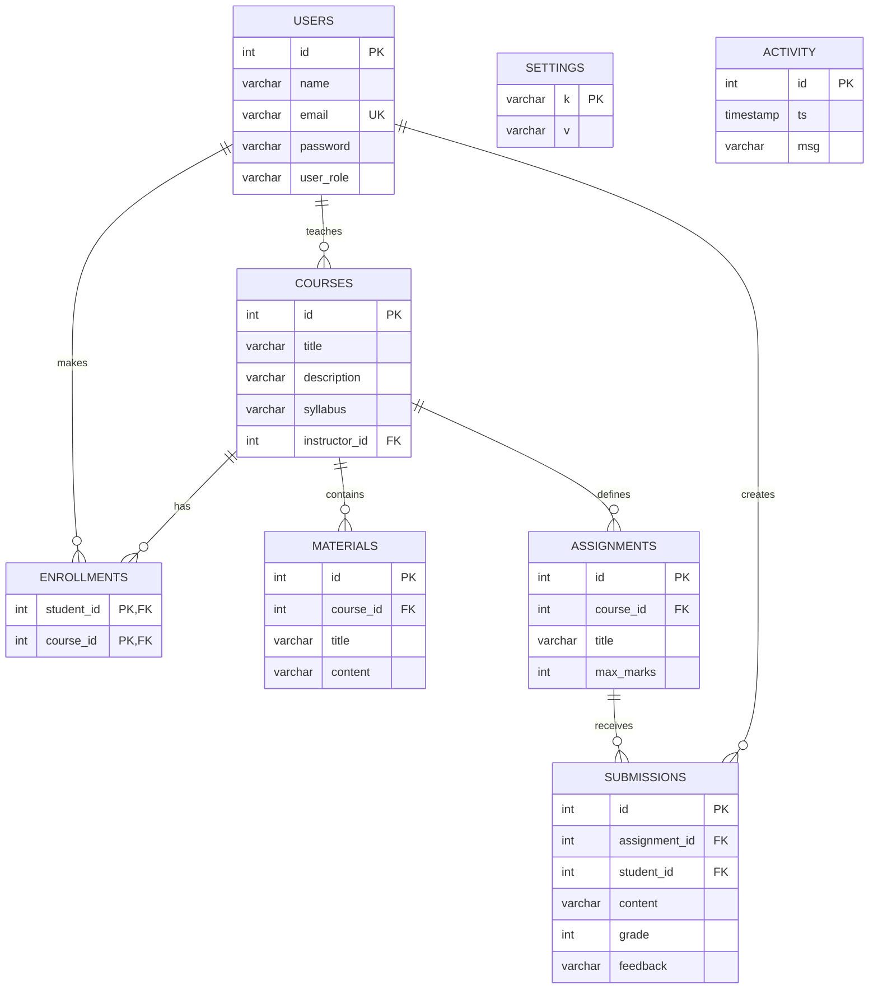

# Database Design — EduLearn LMS

## Database and connectivity

- **DBMS:** H2
- **JDBC URL:** `jdbc:h2:./data/lms`
- **Username:** `sa`
- **Password:** empty for the local academic setup
- **Connection owner:** `lms.Db`
- **Initialization:** `Db.init()` is called during application startup in `App.main()`.

`Db.conn()` opens JDBC connections. Query methods use `PreparedStatement` and bind values with placeholders (`?`). `rows()` returns query results, `one()` returns the first row, `exec()` performs an update, and `tx()` groups multiple SQL updates into a transaction with commit/rollback behavior. Try-with-resources closes JDBC resources.

## Tables

| Table | Primary key | Important columns and constraints | Purpose |
|---|---|---|---|
| `users` | `id` | `email` is UNIQUE; `name`, `email`, `password`, `user_role` are required | Stores administrator, instructor and student accounts. |
| `courses` | `id` | `instructor_id` references `users(id)`; title is required | Stores course details and owning instructor. |
| `enrollments` | Composite: `student_id`, `course_id` | Both columns reference their parent tables; composite primary key prevents duplicate enrollment | Joins students to courses. |
| `materials` | `id` | `course_id` references `courses(id)` | Stores course learning materials. |
| `assignments` | `id` | `course_id` references `courses(id)` | Stores course assignments and maximum marks. |
| `submissions` | `id` | `assignment_id` and `student_id` reference parent tables; UNIQUE(`assignment_id`, `student_id`) | Stores student work, grade and feedback. |
| `settings` | `k` | `v` stores setting value | Stores application settings such as site name and registration status. |
| `activity` | `id` | `ts` defaults to current timestamp | Stores application activity messages. |

## Entity relationships

## Referential integrity

- `courses.instructor_id` references `users.id` with `ON DELETE CASCADE`.
- `enrollments.student_id` and `enrollments.course_id` reference their parent rows with `ON DELETE CASCADE`.
- `materials.course_id` and `assignments.course_id` reference `courses.id` with `ON DELETE CASCADE`.
- `submissions.assignment_id` and `submissions.student_id` reference their parent rows with `ON DELETE CASCADE`.
- Unique constraints prevent duplicate user emails, duplicate student-course enrollments and duplicate submissions for the same assignment/student pair.

## Seed data

On an empty users table, `Db.init()` inserts three demonstration roles, a Java Programming course, a material, an assignment, one enrollment and default settings.

> The schema in this document mirrors the `CREATE TABLE` statements in `src/main/java/lms/Db.java`. Update both this document and the diagram if the schema changes.
